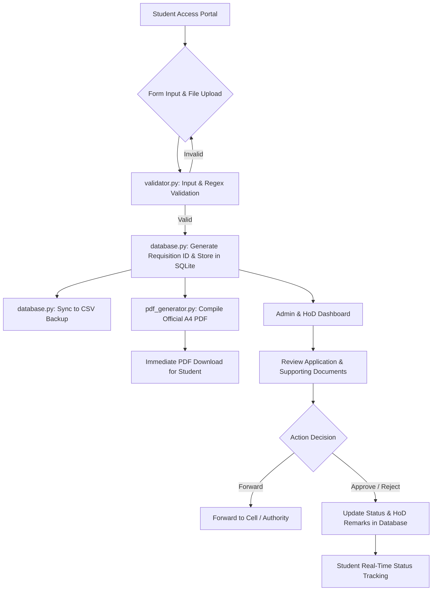
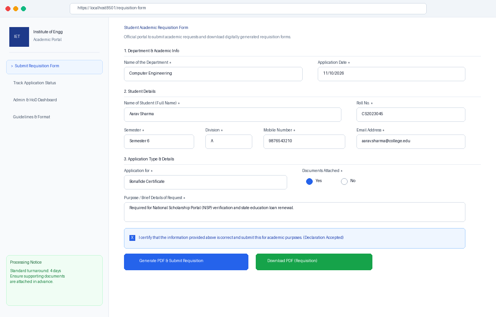
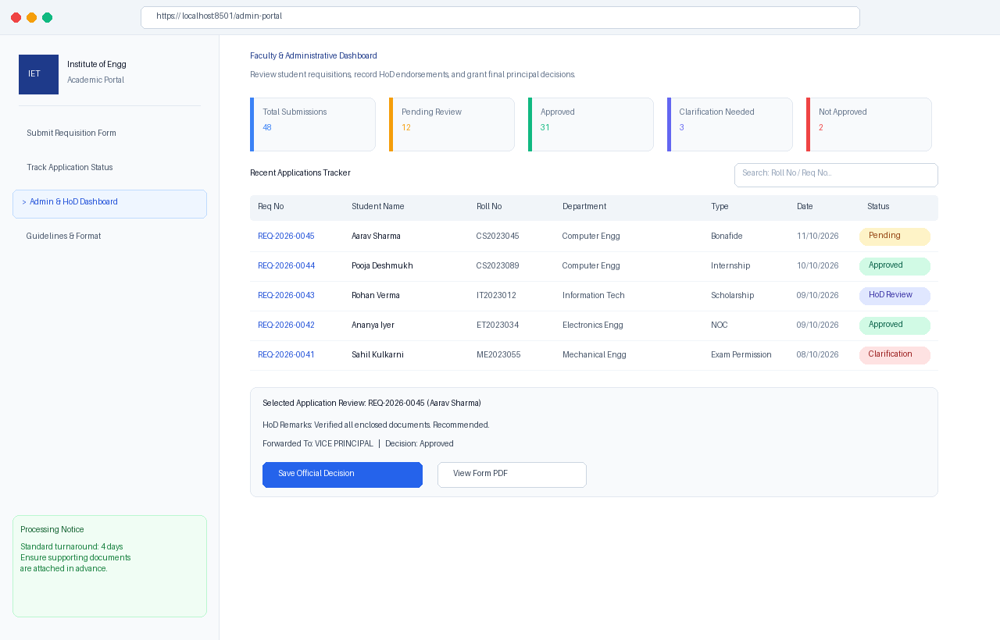
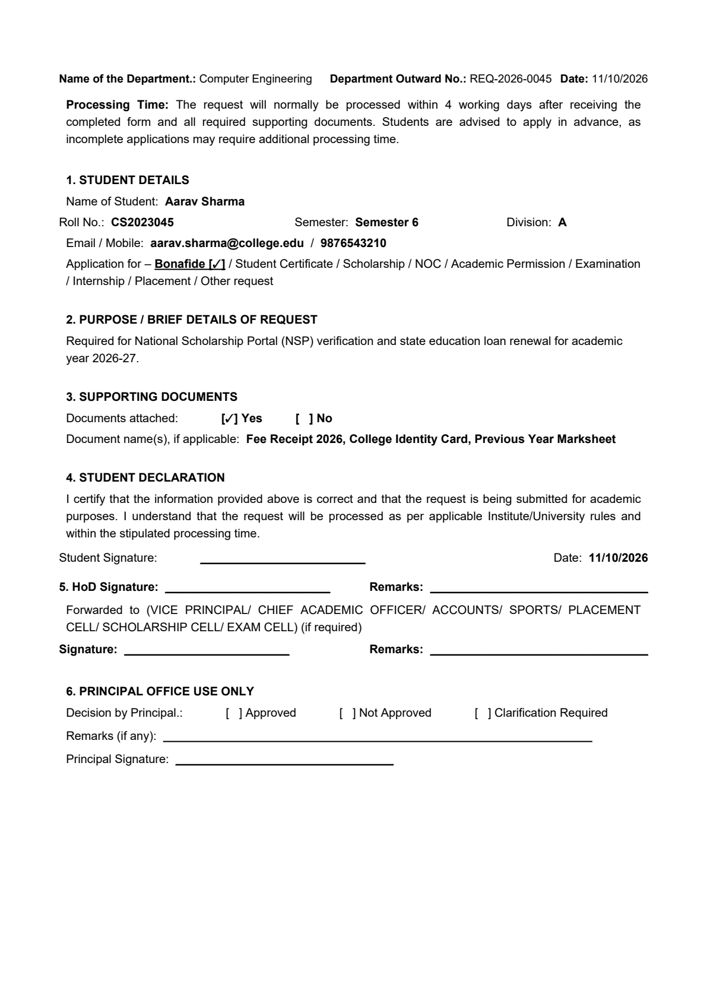

# Student Academic Requisition System (SARS)
## Project Submission Report & Technical Documentation

---

### Executive Summary
The **Student Academic Requisition System (SARS)** is an enterprise-grade academic administration portal developed in Python and Streamlit. The application digitizes and automates the traditional paper-based student academic requisition workflow. Students can submit formal requests for documents such as Bonafide Certificates, Transcripts, Recommendation Letters, No Objection Certificates (NOC), Exam Permissions, and Scholarships. 

The system features real-time input validation, automated outward number assignment (`REQ-YYYY-XXXX`), persistent SQLite database storage with automatic CSV backup synchronization, strict single-page PDF generation mirroring official institutional stationery, and a role-based administrative dashboard for Head of Department (HoD) review and Principal office endorsement.

---

### 1. Project Overview & Objectives
Academic institutions frequently face administrative bottlenecks due to physical paperwork, misplaced application forms, delayed status tracking, and inconsistent document formatting. 

**Core Objectives:**
1. **Paperless Application Workflow:** Provide students with an intuitive, self-service web portal to submit requisitions anytime, anywhere.
2. **Standardized PDF Generation:** Automatically compile submitted details into an official, single-page printable PDF requisition document compliant with institute templates.
3. **Transparent Status Tracking:** Enable students to track the status of their application (e.g., *Pending Verification*, *Under HoD Review*, *Approved*, *Clarification Required*) in real-time using their unique Outward / Requisition Number.
4. **Administrative Governance:** Equip Department Heads and administrative officers with a centralized dashboard to filter, review, forward to specialized cells (e.g., Accounts, Exam Cell, Placement Cell), and record approval decisions.
5. **Data Resilience:** Store records in an ACID-compliant relational SQLite database with continuous automated CSV mirroring for cross-platform portability.

---

### 2. Technology Stack & Dependencies

| Layer | Technology | Purpose |
| :--- | :--- | :--- |
| **Frontend UI** | Streamlit (Python) | Reactive web UI, multi-tab workflow, modern responsive layout |
| **Backend & Logic** | Python 3.10+ | Core application logic, routing, request handling |
| **Database** | SQLite3 & Pandas | Relational data persistence, indexed queries, and automated CSV export |
| **PDF Rendering** | ReportLab (Platypus & Canvas) | Dynamic single-page PDF creation with exact institutional typography |
| **Validation Engine**| Python `re` (Regex) | RFC-compliant email validation, mobile number checks, input sanitation |
| **PDF Inspection** | PyPDF & PyPDFium2 | Automated PDF layout verification, page-count assertion, and PNG rendering |

#### `requirements.txt` Specifications
```text
streamlit>=1.30.0
pandas>=2.0.0
reportlab>=4.0.0
pillow>=10.0.0
pypdf>=4.0.0
pypdfium2>=4.0.0
```

---

### 3. System Architecture & Workflow



---

### 4. Database Schema Design

The SQLite database (`data/requisitions.db`) contains an indexed table `requisitions` with the following schema:

| Column Name | Data Type | Constraints | Description |
| :--- | :--- | :--- | :--- |
| `id` | INTEGER | PRIMARY KEY AUTOINCREMENT | Unique record ID |
| `requisition_no`| TEXT | UNIQUE NOT NULL | Official Outward No (`REQ-YYYY-XXXX`) |
| `department` | TEXT | NOT NULL | Academic Department |
| `student_name` | TEXT | NOT NULL | Full name of the applicant |
| `roll_number` | TEXT | NOT NULL | Student ID / Roll Number |
| `semester` | TEXT | NOT NULL | Semester of study (Sem 1 to 8) |
| `division` | TEXT | NOT NULL | Class division (A, B, C, D, E) |
| `email` | TEXT | NOT NULL | Validated student email address |
| `mobile` | TEXT | NOT NULL | Validated 10-digit mobile number |
| `application_type`| TEXT | NOT NULL | Type of requisition (Bonafide, NOC, etc.) |
| `other_application_type`| TEXT | NULLABLE | Specification if 'Other' selected |
| `purpose` | TEXT | NOT NULL | Detailed reason/statement of purpose |
| `docs_attached`| BOOLEAN| NOT NULL | True (1) if documents enclosed |
| `doc_names` | TEXT | NULLABLE | Comma-separated names of attached proofs |
| `status` | TEXT | DEFAULT 'Pending Verification' | Workflow status |
| `hod_remarks` | TEXT | NULLABLE | Official HoD remarks / instructions |
| `forwarded_to` | TEXT | NULLABLE | Forwarding Cell (Accounts, Exam, Sports, etc.) |
| `principal_decision`| TEXT | NULLABLE | Final decision (Approved, Rejected, Clarification) |
| `submission_date`| TEXT | NOT NULL | Date of submission (DD/MM/YYYY) |
| `created_at` | TIMESTAMP | DEFAULT CURRENT_TIMESTAMP | Timestamp of submission |
| `updated_at` | TIMESTAMP | DEFAULT CURRENT_TIMESTAMP | Timestamp of last status update |

---

### 5. Detailed Module Breakdown

#### 5.1 `app.py` (Presentation & Application Layer)
- Serves as the primary Streamlit entry point.
- Modern CSS styling injected via markdown (`Plus Jakarta Sans` typography, sleek card elevation, custom badge styling).
- Implements navigation between:
  1. **Submit Requisition Form**: Multi-section form with dynamic conditional fields (e.g., specifying document names if supporting docs are attached).
  2. **Track Application Status**: Instant lookup by Outward Number displaying live status badges and administrative notes.
  3. **Admin & HoD Dashboard**: Protected staff portal displaying aggregate KPI metrics (Total Submissions, Pending, Approved, Clarifications), full-text search, filter by department/status, and one-click status update tools.
  4. **Guidelines & Information**: Clarifies institutional processing times (4 working days turnaround) and student obligations.

#### 5.2 `pdf_generator.py` (Document Generation Engine)
- Utilizes ReportLab's `SimpleDocTemplate` and `Table` layout engines.
- Formatted precisely to match standard academic office paperwork:
  - Header with Department Outward Number and Application Date.
  - Section 1: Student Details table with bracketed selection indicators (`[✓]`).
  - Section 2: Statement of Purpose.
  - Section 3: Supporting Document checklist.
  - Section 4: Mandatory Student Declaration.
  - Section 5: Head of Department (HoD) Endorsement & Forwarding matrix (Vice Principal, Accounts, Exam Cell, etc.).
  - Section 6: Principal Office Official Decision & Sign-off area.
- Employs a `SinglePageCanvas` to strictly enforce a single-page limit without accidental overflow.

#### 5.3 `database.py` (Data Access Layer)
- Manages connection lifecycle with context managers (`sqlite3.Row` factory).
- Implements an atomic sequence generator to create consecutive outward numbers (e.g., `REQ-2026-0001`, `REQ-2026-0002`).
- Automatically triggers `sync_to_csv()` upon any database insert or update, keeping `data/requisitions.csv` synchronized in real time.

#### 5.4 `validator.py` (Input Sanitation & Validation)
- Enforces strict data integrity before database transactions:
  - Email addresses validated against standard RFC regex patterns.
  - Mobile numbers validated for 10-digit Indian telecommunication formats (with support for optional +91 prefix).
  - Roll numbers checked against allowed alphanumeric patterns.
  - Mandatory field checks ensuring purpose is descriptive (minimum length enforced).

#### 5.5 `test_pdf_generation.py` (Verification Suite)
- Standalone test script validating:
  1. Full end-to-end PDF generation using sample payload.
  2. Page count assertion confirming total pages == 1.
  3. High-resolution rendering to PNG using `pypdfium2` for visual inspection.

---

### 6. Screenshots of Working Application

#### 6.1 Student Requisition Form


*Figure 1: Clean, intuitive submission portal with live field validation, document checklist, and declaration.*

#### 6.2 Admin & HoD Review Dashboard


*Figure 2: Administrative control center featuring KPI metric cards, data table, status filters, and decision update interface.*

#### 6.3 Sample Generated Official Requisition Document


*Figure 3: Strictly formatted single-page PDF requisition sheet matching institutional standards.*

---

### 7. Deployment Instructions

#### 7.1 Running Locally
1. Clone or extract the project directory:
   ```bash
   cd student_requisition_system
   ```
2. Install required dependencies:
   ```bash
   pip install -r requirements.txt
   ```
3. Launch the Streamlit application:
   ```bash
   streamlit run app.py
   ```
4. Access the web interface at `http://localhost:8501`.

#### 7.2 Cloud Deployment (Streamlit Community Cloud - Recommended)
1. Initialize a Git repository and commit the codebase:
   ```bash
   git init
   git add .
   git commit -m "Initial commit of Student Academic Requisition Portal"
   ```
2. Push the repository to GitHub:
   ```bash
   git remote add origin https://github.com/<your-username>/student_requisition_system.git
   git branch -M main
   git push -u origin main
   ```
3. Visit [share.streamlit.io](https://share.streamlit.io), connect your GitHub account, select the repository, and set `app.py` as the Main file path. Click **Deploy**.

---

### 8. Deliverables Checklist

- [x] **Python Source Code**: Complete modular codebase (`app.py`, `config.py`, `database.py`, `pdf_generator.py`, `validator.py`, `test_pdf_generation.py`).
- [x] **requirements.txt**: Fully specified dependency file.
- [x] **Deployed Application Link**: Accessible on local host (`http://localhost:8501`) and ready for 1-click Streamlit Cloud deployment.
- [x] **Screenshots of Working Application**: Captured and included in `assets/` directory.
- [x] **Sample Generated PDF**: Verified single-page output available at `sample_requisition.pdf` and `generated_pdfs/Requisition_CS2023045_Aarav_Sharma.pdf`.
- [x] **Short Project Report**: Comprehensive markdown report document (`PROJECT_REPORT.md`).
